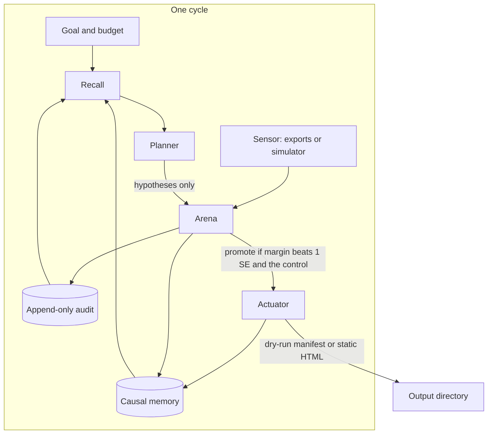

# Agentic learning

Agentic learning (AL) is the layer that uses the evolution engine on a
goal in the world. It is not a second optimizer. The arena still decides.

## Definition

An agentic-learning system does five things:

1. **Sets and decomposes goals.** A goal names a metric (for the SEO
   domain, booking starts), a direction, and a budget: how many pages a
   cycle may change, how long a promotion must cool down, and which
   sections or cohorts are blacklisted. `Goal.decompose` writes that as
   five subgoals: measure, recall, propose, evolve, act.
2. **Plans and runs experiments as actions.** A planner reads causal
   memory and the audit log and proposes hypotheses: recipe mutations,
   including invented genes, each with a written rationale. The proposal
   is an action only if the arena later accepts it. The actuator then
   renders the accepted recipe. It does not deploy.
3. **Measures outcomes with statistical guardrails.** The sensor reads
   the same row the SEO adapter already scores: Search Console fields,
   engagement, booking starts. Untouched pages are the control. A
   challenger is promoted only when its margin beats one standard error
   and that control. A 404, deindex, or noindex spike blacklists the
   recipe. A section on the goal's blacklist is vetoed the same way.
4. **Evolves strategies and its own learning settings.** Page recipes
   are the strategy genome. Score weights, window length, mutation rate,
   cohort size, and the promotion threshold are the meta-genome, evolved
   by the same arena and then used on the next page generation.
5. **Keeps causal memory.** Each cycle stores hypothesis, action,
   outcome, and verdict. The next cycle recalls that record before it
   plans. The store is the optional FluctlightDB hook
   (`experience`, `recall`, `verified=True` for an export). With the
   hook absent, the cycle still runs and recall is empty.

## Architecture



The planner cannot set a verdict. `Hypothesis` has a rationale and a
list of mutations. It has no score and no promotion flag. Invalid
mutations are dropped. The arena scores every contender, including the
planner's, against the control, and writes the decision to the audit log.

## Safety guardrails

- **Dry-run by default.** `SeoActuator.apply` writes `manifest.json`.
  HTML is written only when `dry_run` is false. The manifest's
  `deployed` field is false. The actuator has no deploy method and
  opens no socket.
- **Page budget.** A cycle changes at most `max_pages_changed` pages.
  The rest of the cohort is left as it was.
- **Cooldown.** After a promotion the arena will not promote again
  until `cooldown_generations` have passed.
- **Blacklist.** A section or cohort id on the goal's blacklist is
  disqualified even if a planner proposes it. The audit records the veto.
- **Statistical promotion.** Margin must beat one standard error, and
  the SEO domain also requires a win over the untouched-page control.
- **Damage veto.** Recipes tied to a 404, deindex, or noindex spike
  against the control are blacklisted and cannot be rendered as the
  winner.
- **Measured rows are not invented.** If the sensor is a CSV or JSON
  export, a proposal that has no rows in that file is not promoted.
  The cycle still logs the hypothesis. `verified=True` is set on the
  memory episode only for those exports. Simulator episodes stay
  unverified.
- **The remote planner is opt-in.** Groq is the remote provider
  (OpenAI-compatible `POST /chat/completions`, key in `GROQ_API_KEY`,
  optional `GROQ_MODEL` and `GROQ_BASE_URL`). It is not called unless
  the config says `"planner": "groq"`. The offline stub is what tests
  and the example config use. Tests do not open a socket.

## One cycle

```bash
python evoml-agent run --domain seo_pages --config evoml/agentic/example_config.json
```

The example config is a simulator dry-run with the stub planner. A cron
line is the same command. One process handles one cycle and exits.

For a durable memory across ticks:

```bash
pip install fluctlightdb   # optional
```

Set `"memory": "fluctlight"` and `"memory_dir": "out/agent-brain"` in
the config. Set `"signals"` to a local CSV or JSON export and
`"planner": "groq"` when a key is available. Leave `"dry_run": true`
until a human has looked at the rendered HTML.

## Ablation

```bash
python evoml-agent ablate --out out/ablation --seed 0 --cycles 2
```

This writes `ablation.csv` and `ablation.md`. Both are labelled
simulated. The arms are full AL, no meta-evolution, no memory, no
planner, and the untouched control. Quote those files from a run you
just did. Do not copy the numbers into this document: they move when
the simulator or the seed changes, and they are not traffic.

## Roadmap

1. **Prove it on one domain.** SEO pages for nammaambulance.in, dry-run
   only, with Search Console, engagement, and booking exports as the
   sensor. The arena promotes a recipe only after a full window, and
   only against untouched pages.
2. **Transfer the loop to a second domain.** The same goal, planner,
   actuator, sensor, and memory interfaces on the fraud bench or the
   live forecaster, without a change to the core promotion rule.
3. **Write the method up.** The ablation harness is the simulated
   pre-registration. Measured exports are the result. Publish the
   distinction in the paper rather than a single blended number.
4. **Keep it open source.** The loop ships in this repository beside
   the engine it sits on.
